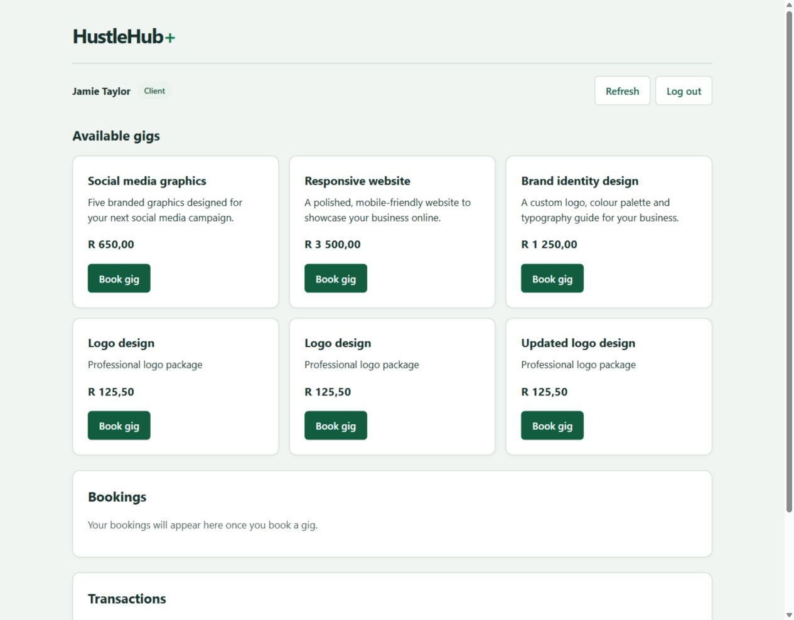
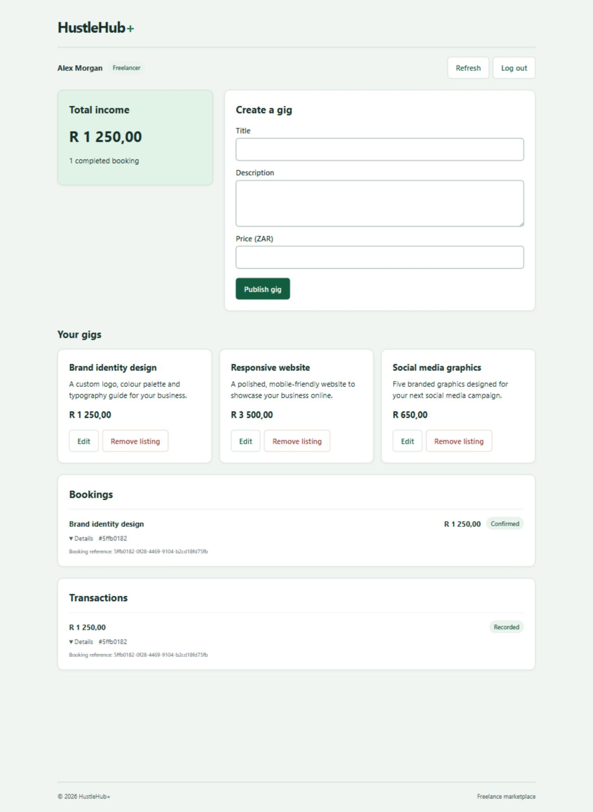
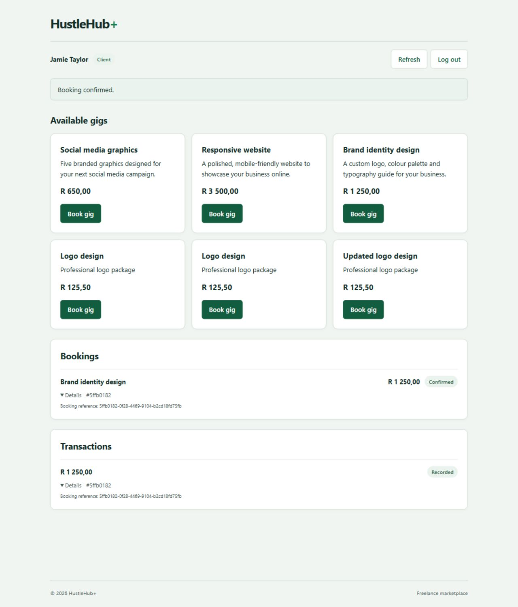
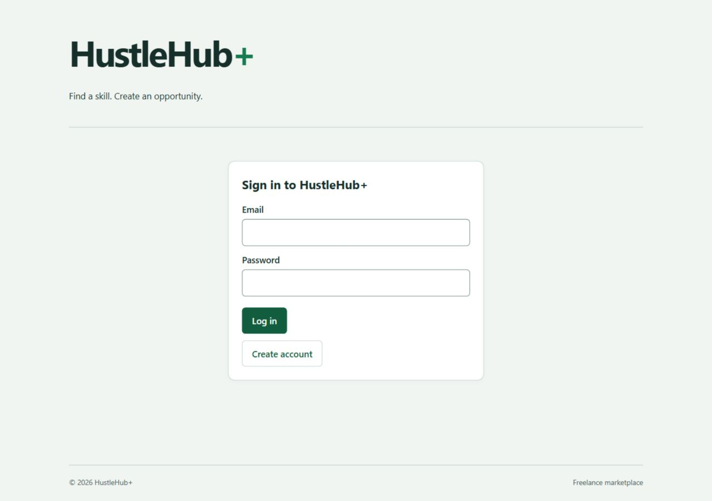
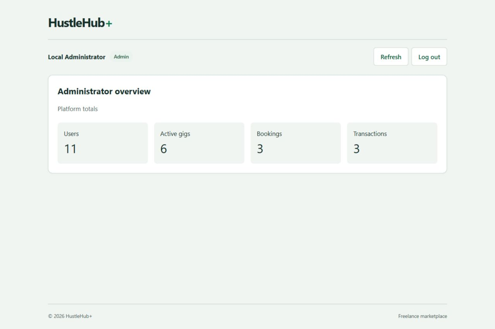
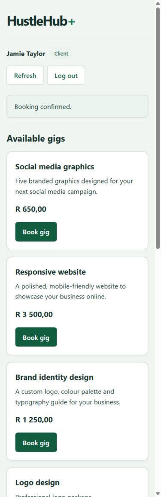

# HustleHub+

A secure freelance marketplace where freelancers publish services and clients browse and book them. Confirmed bookings create simulated payment transactions, and freelancers get an income dashboard with an educational tax estimate. The application is built with React, Node.js, Express and MongoDB, and runs as a Docker Compose stack behind HTTPS.

The project focuses on application security: authentication and session handling, role and ownership checks, input validation, structured logging and an automated verification pipeline.

Built by a team of four for INSY7314 at Emeris Durban North (2026).

**Demo video:** [Watch on YouTube](https://youtu.be/v8cnh0CgoJU)



## Features

- **Marketplace:** clients browse active gigs, book them and view their booking and transaction history.
- **Freelancer workspace:** freelancers create and manage their own gigs and see related bookings and transactions.
- **Income dashboard:** a calendar-year view of gross income, estimated tax and the remainder, with a monthly chart and an exact-value table.
- **Administration:** a protected summary of platform totals. Administrator accounts are created from the command line, never through public registration.
- **Simulated payments:** prices are set by the server, and booking and transaction creation happen in one MongoDB transaction with idempotent requests to prevent duplicates.

## Security

| Threat | Protection |
| --- | --- |
| Credential guessing | Salted bcrypt hashes, per-IP rate limiting, and a persistent five-minute account lockout after five failed attempts |
| Token misuse | JWT verification of algorithm, signature, expiry, issuer, audience and claims; current-user and role checks; server-side revocation on logout |
| Broken access control | Role checks and ownership filters on gigs, bookings, transactions and finance data |
| Injection and XSS | Exact-field validation, typed identifiers, React escaping and a restrictive Content Security Policy via Helmet |
| Financial tampering | Server-derived prices, atomic transactions and idempotency keys |
| Data disclosure | Controlled error responses, `no-store` headers and allowlisted structured logs that exclude passwords, tokens and request bodies |
| Container exposure | Only the API is published, on loopback; the client and database stay on a private network in non-root, read-only containers |

## Tech stack

| Area | Technologies |
| --- | --- |
| Frontend | React, Vite, Vitest |
| Backend | Node.js 22, Express, Mongoose, JSON Web Tokens, bcrypt, Helmet |
| Database | MongoDB replica set (for transactions) |
| Infrastructure | Docker Compose, Nginx, HTTPS |
| Monitoring | Structured JSON logs, optional Grafana Cloud Loki forwarding |
| Quality | ESLint with security rules, Newman (Postman) API suites, dependency audits, GitHub Actions |

## Architecture

```text
Browser (React) --HTTPS--> Express API --private network--> MongoDB replica set
                               |
                               |-- serves the built client from the Nginx container
                               '-- JSON logs to the console and, optionally, Grafana Cloud Loki
```

The backend separates routes, validators, access middleware, controllers and models. React keeps the access token in memory. Login, logout, rejected tokens, confirmed bookings, recorded transactions and request errors are logged as correlated events that share a request identifier.

### Income and tax estimate

`GET /api/finance?year=2026` returns the signed-in freelancer's monthly income totals, annual gross income, estimated tax and remainder. Amounts are stored as integer cents, and the estimate applies a flat 20% using `BigInt` arithmetic with a single half-up rounding step. The estimate is educational only: it ignores tax brackets, rebates and deductions and is not a SARS calculation.

## Screenshots

| Freelancer workspace | Bookings and transactions |
| --- | --- |
|  |  |

| Sign in | Administrator overview |
| --- | --- |
|  |  |

<details>
<summary>Mobile layout</summary>



</details>

## Getting started

### Prerequisites

- Node.js 22.13 or later (22.x) and npm
- Docker with Docker Compose
- OpenSSL, to create a local development certificate

### 1. Install dependencies

```bash
npm ci
npm --prefix backend ci
npm --prefix client ci
```

### 2. Create a localhost certificate

```bash
openssl req -x509 -newkey rsa:2048 -sha256 -nodes \
  -keyout backend/certs/localhost-key.pem -out backend/certs/localhost-cert.pem \
  -days 30 -subj '/CN=localhost' \
  -addext 'subjectAltName=DNS:localhost,IP:127.0.0.1,IP:::1'
```

Trust the certificate in your operating system's certificate store. The `backend/certs` folder is ignored by Git, so the private key is never committed.

### 3. Configure the environment

```bash
cp .env.compose.example .env.compose
```

Replace the three placeholder secrets with different random values, for example from:

```bash
node -e "console.log(require('node:crypto').randomBytes(48).toString('hex'))"
```

The `LOKI_*` settings are optional. Leave them blank to log to the console only.

### 4. Start the stack

```bash
docker compose --env-file .env.compose up --build -d --wait
```

Open `https://localhost:3443`. The health check is at `https://localhost:3443/api/health`.

### 5. Create an administrator

```bash
read -rp 'Administrator email: ' ADMIN_EMAIL
read -rsp 'Administrator password: ' ADMIN_PASSWORD; echo
ADMIN_EMAIL="$ADMIN_EMAIL" ADMIN_PASSWORD="$ADMIN_PASSWORD" \
  docker compose --env-file .env.compose exec -e ADMIN_EMAIL -e ADMIN_PASSWORD api npm run create-admin
unset ADMIN_PASSWORD
```

Clients and freelancers register through the application.

To stop the stack while keeping its data, run `docker compose --env-file .env.compose down`.

### Running without Docker

Copy `backend/.env.example` to `backend/.env`, point `MONGODB_URI` at a MongoDB deployment that supports transactions, then run:

```bash
npm --prefix client run build
npm --prefix backend start
```

## Testing

```bash
npm run lint
npm --prefix backend run test:unit
npm --prefix backend test
npm --prefix client test
```

The API suites start an isolated MongoDB replica set and HTTPS server, then run the Newman collections in `postman/` against it. With the Compose stack running, `npm run test:stack` checks the deployed containers and restarts the API to confirm data persists. Use a disposable local stack for this.

The GitHub Actions workflows run linting, dependency audits, all test suites, both builds and a full container start-up check. They are set to run manually.

## Project structure

```text
backend/     Express API: routes, validators, middleware, controllers, models, tests
client/      React frontend and Nginx container
postman/     API test collections run by the backend test suite
scripts/     MongoDB initialisation and stack verification
docs/        Screenshots
```

## Team

| Member | Contribution |
| --- | --- |
| Khayden Chetty | Express backend and registration, MongoDB persistence, persistent account lockout, token revocation and audit events |
| Rivaan Kawulesar | Password hashing and JWT login, marketplace routes and atomic bookings, finance API, tax calculation and financial event logging |
| Stephane Nsengiyumva | HTTPS server and error handling, Postman and integration tests, administrator setup tool, static analysis, Docker Compose and GitHub Actions |
| Zenwyn Naicker | Input validation, MERN architecture, React frontend and CI, income dashboard, frontend tests and documentation |

## Acknowledgements

Frameworks, libraries, documentation and adapted code patterns are credited in [CODE_ATTRIBUTION.txt](CODE_ATTRIBUTION.txt).
